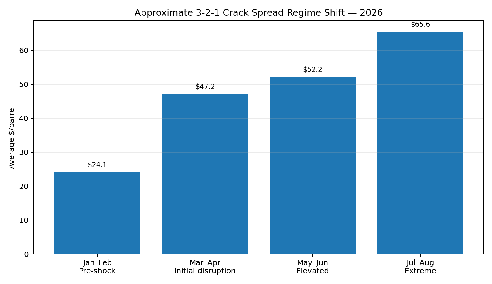
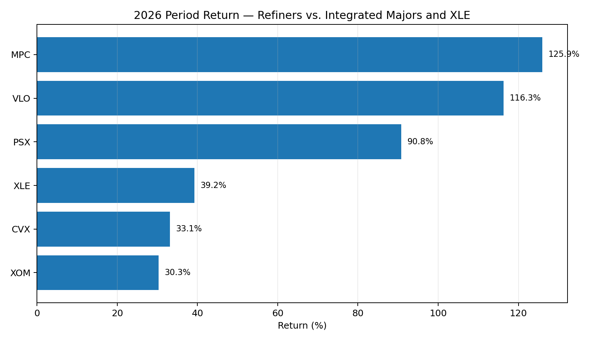
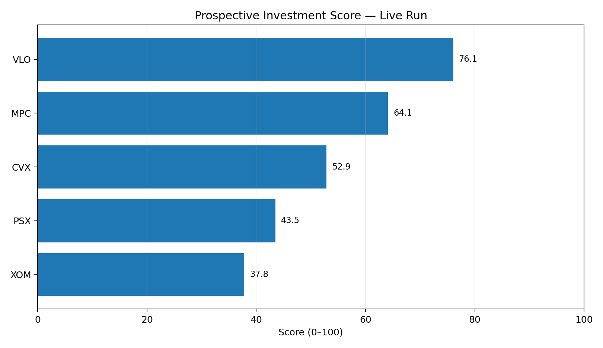
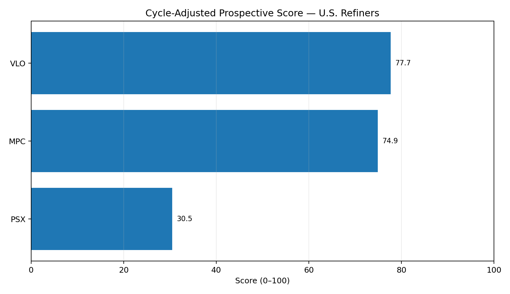

# Hormuz U.S. Energy Investment Exposure Model

A reproducible investment-intelligence model evaluating how the 2026 Strait of Hormuz disruption affected U.S. refiners and integrated oil majors — and whether the strongest beneficiaries still offer attractive prospective exposure after a large market rally.

**Current model version:** 0.5.1  
**Validated live run:** August 29, 2026  
**Observed market sample:** January 2–August 28, 2026  
**Universe:** VLO, MPC, PSX, XOM, CVX

> Research project only. This repository does not provide investment advice or price targets.

## Executive finding

The model finds a clear 2026 transmission chain:

**Hormuz disruption → higher refined-product scarcity → wider U.S. crack spreads → stronger refiner economics → refiner equity outperformance.**

The approximate 3-2-1 crack spread rose from an average of **$24.15/bbl in January–February** to **$65.55/bbl in the July–August regime**, a roughly **171% increase**. The July–August regime is defined through August 31, but the latest observed market data in the validated run are through **August 28, 2026**.



Refining-heavy equities also materially outperformed XLE and the integrated majors during the validated 2026 market sample.



## Current model result

| Rank | Company | Exposure score | Valuation score | Prospective score |
|---:|---|---:|---:|---:|
| 1 | **Valero Energy (VLO)** | 72.48 | 76.95 | **74.49** |
| 2 | Marathon Petroleum (MPC) | 58.00 | 71.34 | **64.00** |
| 3 | Chevron (CVX) | 55.64 | 51.29 | 53.68 |
| 4 | Phillips 66 (PSX) | 54.49 | 28.93 | 42.99 |
| 5 | Exxon Mobil (XOM) | 46.32 | 27.41 | 37.81 |



### Cycle-normalization test

The project does **not** assume Q2 2026 refining margins persist indefinitely. VLO, MPC, and PSX are stressed toward issuer-specific mid-cycle margins.

| Refiner | Prospective score | Mid-cycle earnings retained | Soft-cycle earnings retained | Cycle-adjusted score |
|---|---:|---:|---:|---:|
| **VLO** | 74.49 | 26.61% | 12.75% | **76.56** |
| **MPC** | 64.00 | **29.81%** | **15.04%** | **74.80** |
| PSX | 42.99 | 13.24% | 1.21% | 30.09 |



**Interpretation:** Valero remains the highest-ranked refiner in the combined framework, while Marathon is the strongest normalization hedge and closes the gap materially when refining margins revert toward historical levels.

## Normalized valuation stress test

Version 0.5.1 adds an explicit valuation-normalization layer designed to test whether apparently low current multiples remain attractive when unusually strong Q2 2026 refining economics are replaced with modeled mid-cycle or soft-cycle conditions.

### Q2-replacement EV/EBITDA bridge

| Refiner | Current EV/EBITDA | Mid-cycle Q2 replacement | Soft-cycle Q2 replacement |
|---|---:|---:|---:|
| **VLO** | 7.84x | **10.37x** | 11.04x |
| MPC | 8.45x | 12.13x | 13.35x |
| PSX | 11.40x | 15.56x | 16.39x |

The bridge holds enterprise value constant and replaces the modeled Q2 2026 segment contribution with the corresponding mid-cycle or soft-cycle earnings proxy.

This is a **sensitivity diagnostic**, not a consolidated EBITDA forecast or price target. VLO and PSX segment proxies are not reported EBITDA measures, so the bridge assumes the modeled change in segment economics flows through to EBITDA while depreciation, amortization, and non-refining items remain unchanged.

### Pass-through sensitivity

Version 0.5.1 also tests 50%, 75%, and 100% pass-through of modeled segment earnings deterioration into consolidated valuation measures.

This provides a harsher stress case than the quarter-replacement bridge and shows that the relative VLO-versus-MPC conclusion is assumption-sensitive rather than mechanically fixed.

**Interpretation:** VLO retains the stronger mid-cycle EV/EBITDA profile in the quarter-replacement bridge, but MPC's superior modeled cycle retention becomes increasingly valuable as pass-through assumptions become more severe.

## Why the result is interesting

This is not a generic “higher oil prices are good for energy stocks” model. It separates several competing effects:

- U.S. refiners can benefit from scarce global refining/product supply and wider crack spreads.
- Integrated majors benefit from higher upstream prices but may also carry direct Middle East production, logistics, or asset exposure.
- A strong operating beneficiary may still be a poor prospective investment if the market has already fully rerated the stock.
- Refining businesses can look optically cheap near the top of the cycle, so mid-cycle normalization must be tested explicitly.
- Low forward valuation multiples can become materially less attractive when extreme refining conditions are normalized.

## Model architecture

The pipeline is:

```text
Primary-source evidence
        ↓
Hormuz-flow shock benchmark
        ↓
Operational exposure factors
        ↓
Live market confirmation
        ↓
Valuation and balance-sheet layer
        ↓
Scenario scoring
        ↓
10,000-run Monte Carlo sensitivity
        ↓
Refining-cycle normalization
        ↓
Prospective / cycle-adjusted ranking
        ↓
Normalized valuation stress testing
```

### Operational factors

- Peer operating uplift
- Refining-shock capture
- Middle East resilience
- Upstream price hedge
- Scale resilience
- Live equity-market confirmation

### Valuation factors

- Forward P/E
- EV/EBITDA
- Free-cash-flow yield
- Dividend yield
- Net debt / EBITDA
- Multiple rerating versus FY2025

### Scenarios

1. **Normalization**
2. **Persistent disruption**
3. **Severe disruption**

The persistent-disruption scenario is also subjected to a **10,000-run Monte Carlo sensitivity test**.

## Live market evidence

The validated market-data sample runs from **January 2 through August 28, 2026**.

The live run produced the following period returns:

| Ticker | Return |
|---|---:|
| MPC | 125.94% |
| VLO | 116.31% |
| PSX | 90.79% |
| XLE | 39.20% |
| CVX | 33.10% |
| XOM | 30.33% |

Following the initial major Hormuz disruption event, 20-trading-day returns were:

| Ticker | 20-day return |
|---|---:|
| MPC | 16.84% |
| VLO | 16.45% |
| PSX | 15.38% |
| XOM | 11.19% |
| CVX | 11.13% |
| XLE | 9.34% |

The event-window results are descriptive rather than causal proof, but they provide useful market confirmation alongside the operating data.

## Refining-cycle normalization

The model estimates refiner resilience under six operating regimes:

1. Q2 2026 extreme
2. 75% of the Q2 margin premium retained
3. 50% retained
4. 25% retained
5. Mid-cycle
6. 20% below normalized margin

Issuer-specific historical refining margins provide the normalization anchors.

The cycle-resilience score is based on a blend of:

- **70% mid-cycle earnings retention**
- **30% soft-cycle earnings retention**

The final cycle-adjusted prospective score is:

```text
70% × prospective score
+
30% × cycle-resilience score
```

## Valuation methodology

The prospective valuation score is peer-normalized across six components:

| Component | Weight | Direction |
|---|---:|---|
| Forward P/E | 25% | Lower is better |
| EV/EBITDA | 20% | Lower is better |
| FCF yield | 25% | Higher is better |
| Dividend yield | 10% | Higher is better |
| Net debt / EBITDA | 15% | Lower is better |
| EV/EBITDA rerating vs. FY2025 | 5% | Less expansion is better |

The prospective score is:

```text
55% × exposure average
+
45% × valuation score
```

Valuation receives a relatively high weight because the historical shock trade has already generated substantial equity gains.

## Data and source discipline

The project uses primary-source or market-observable inputs wherever practical.

### Primary sources

- U.S. Energy Information Administration — Hormuz flows and energy-market disruption
- SEC filings — VLO, MPC, PSX, XOM, and CVX operating/financial disclosures
- Issuer historical filings — refining-margin normalization anchors

See [`research/source_register.csv`](research/source_register.csv) for the detailed source register.

### Market data

When internet access is available, `yfinance` is used to retrieve:

- VLO, MPC, PSX, XOM, CVX
- XLE
- Brent (`BZ=F`)
- WTI (`CL=F`)
- RBOB gasoline (`RB=F`)
- Distillate / heating oil (`HO=F`)

Version 0.5.1 records the actual start and end dates used for each market-performance calculation.

## Project structure

```text
.
├── charts/
│   ├── crack_spread_regimes.png
│   ├── equity_performance_2026.png
│   ├── prospective_investment_scores.png
│   └── cycle_adjusted_refiner_scores.png
├── data/
│   ├── company_metrics.csv
│   ├── cycle_normalization_inputs.csv
│   ├── event_dates.csv
│   ├── hormuz_flows_eia.csv
│   ├── normalized_valuation_fundamentals.csv
│   └── valuation_current.csv
├── outputs/
│   ├── crack_321_proxy.csv
│   ├── crack_regime_summary.csv
│   ├── cycle_adjusted_refiner_ranking.csv
│   ├── cycle_normalization_scenarios.csv
│   ├── cycle_resilience.csv
│   ├── event_window_returns.csv
│   ├── factor_table.csv
│   ├── market_performance.csv
│   ├── market_prices.csv
│   ├── monte_carlo_persistent.csv
│   ├── normalized_q2_replacement_ev_ebitda_bridge.csv
│   ├── normalized_valuation_pass_through_sensitivity.csv
│   ├── prospective_investment_ranking.csv
│   ├── scenario_scores.csv
│   └── valuation_scores_current.csv
├── research/
│   ├── article_research_outline.md
│   ├── crack_spread_methodology.md
│   ├── cycle_normalization_methodology.md
│   ├── findings_snapshot.md
│   ├── normalized_valuation_methodology.md
│   ├── source_register.csv
│   ├── validation_notes.md
│   └── valuation_source_register.csv
├── src/
│   ├── backtest.py
│   ├── crack_regimes.py
│   ├── crack_spread.py
│   ├── cycle_normalization.py
│   ├── final_rank.py
│   ├── investment_rank.py
│   ├── market_data.py
│   ├── model.py
│   ├── monte_carlo.py
│   ├── normalized_valuation.py
│   └── valuation.py
├── tests/
│   ├── test_smoke.py
│   └── test_v051.py
├── main.py
├── VERSION
└── requirements.txt
```

## Run locally

### Windows PowerShell

```powershell
python -m venv .venv
.\.venv\Scripts\Activate.ps1
pip install -r requirements.txt
python main.py
```

If the market-data pull succeeds, the model refreshes:

- market performance;
- observed sample dates;
- event-window returns;
- crack-spread estimates;
- regime observation cutoffs;
- prospective rankings;
- cycle-adjusted rankings;
- normalized valuation stress tests.

## Run validation checks

```powershell
python -m unittest discover -s tests -v
```

Version 0.5.1 includes **seven validation tests** covering:

- core scenario production;
- bounded valuation scores;
- cycle-normalization scenarios;
- crack-regime observation cutoffs;
- market-performance sample dates;
- positive normalized valuation outputs;
- VLO-versus-MPC mid-cycle bridge behavior.

## Key limitations

- This is a comparative research model, not an expected-return estimator.
- Forward valuation metrics can change quickly and should be refreshed before publication or investment use.
- Crack spreads are market proxies and differ from issuer-specific realized margins.
- Cycle-normalization uses transparent segment-level sensitivity bridges, not consolidated EPS forecasts.
- The normalized EV/EBITDA bridge holds enterprise value constant and uses simplifying pass-through assumptions.
- VLO and PSX segment proxies are not reported EBITDA measures.
- Event-window returns do not establish causality.
- Some geographic exposure and business-model factors remain explicit analyst parameters because issuer disclosures are not standardized across the universe.
- Refining margins can revert sharply; apparent low valuation multiples can therefore be cyclical rather than structural bargains.
- The model does not generate price targets.

## Research conclusion

The validated v0.5.1 live run supports **Valero Energy as the strongest overall prospective exposure in the five-company universe**, based on the combination of operational exposure, refreshed valuation, cash-flow characteristics, balance-sheet resilience, market confirmation, and normalized valuation sensitivity.

**Marathon Petroleum remains the strongest competing thesis.** It delivered the highest 2026 equity return in the sample and retains more modeled segment earnings than VLO when margins normalize.

The new normalized valuation layer sharpens the comparison. VLO's current EV/EBITDA rises from **7.84x to approximately 10.37x** when the extreme Q2 segment contribution is replaced with a modeled mid-cycle result, while MPC rises from **8.45x to approximately 12.13x**.

That result preserves VLO's relative valuation advantage in the quarter-replacement bridge, but the broader pass-through sensitivity shows that MPC's stronger cycle retention can become more valuable under harsher normalization assumptions.

Phillips 66 participated strongly in the initial trade, but both the cycle-normalization and normalized-valuation analyses suggest materially greater sensitivity to a reversal in elevated refining economics.

The central risk to the VLO thesis is therefore not whether the Hormuz disruption improved U.S. refining economics — the model finds substantial evidence that it did — but whether the market is capitalizing an unusually favorable refining regime for too long.

## Related research note

See [`research/article_research_outline.md`](research/article_research_outline.md) for a publication-oriented research structure.

Any external publication should clearly distinguish:

- primary-source facts;
- market-derived calculations;
- model outputs;
- analyst interpretation.

Research only; not investment advice.
